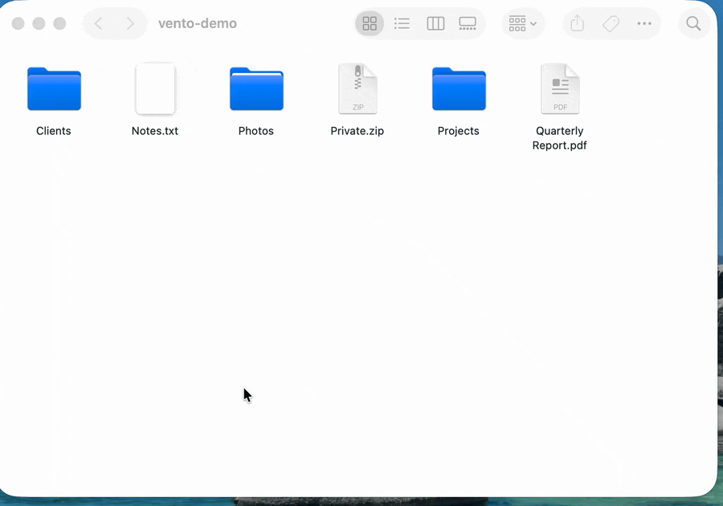
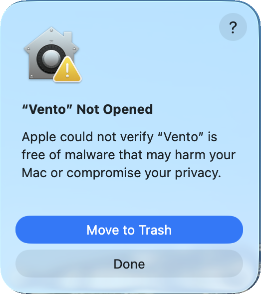
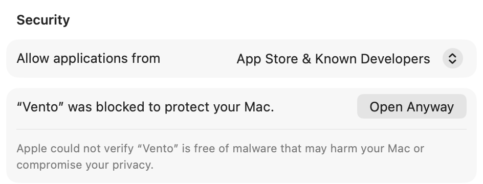
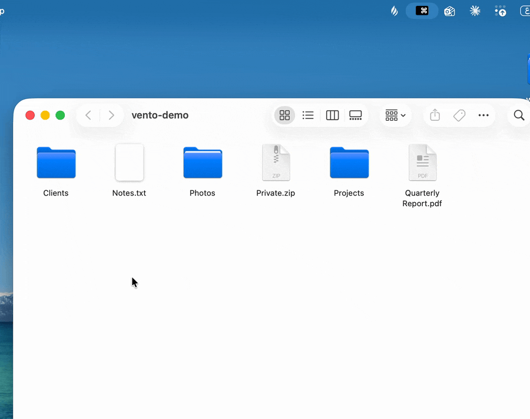
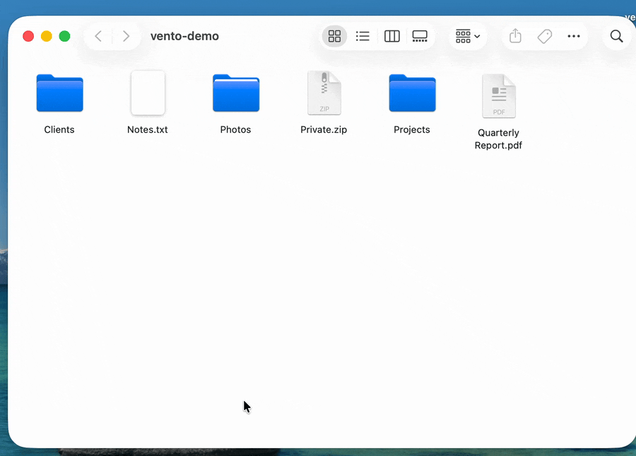
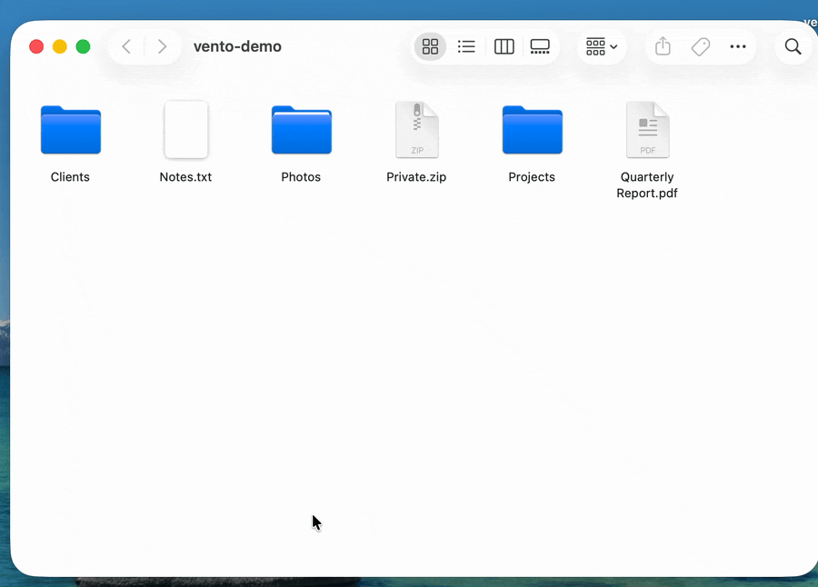
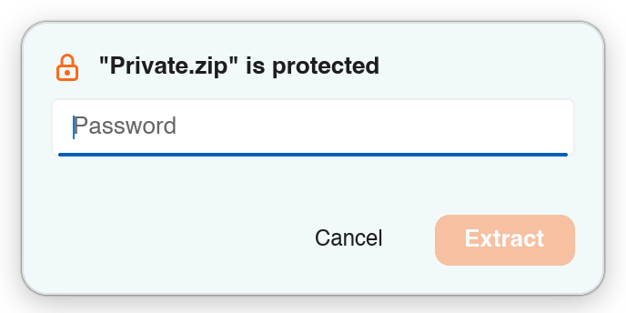
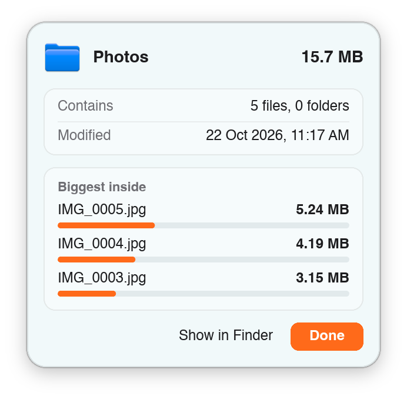
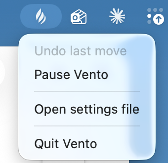

<p align="center">
  <picture>
    <source media="(prefers-color-scheme: dark)" srcset=".github/assets/logo-dark.png">
    
  </picture>
</p>

<p align="center">A wheel of quick actions that opens right under the file you are dragging.</p>



Start dragging a file, press **Ctrl**, and a small wheel opens under the pointer.
Let go over an action: copy the file, move it to a folder you use often, zip it,
turn an image into JPEG, PNG, HEIC, WebP and other formats, park it in the
Pocket for later, and more. Let go anywhere else and the drop works as it
always did.

## Download

**[Download the latest Vento](https://github.com/fathialamre/vento/releases/latest)**
(`vento-…-macos-arm64.zip`)

Vento is in **early beta**. If something breaks or feels off, please
[open an issue](https://github.com/fathialamre/vento/issues).

Needs macOS 13 or later on an Apple Silicon Mac (M1 or newer). Vento asks for no
special permissions: no Accessibility, no Input Monitoring. Only
[Copy from screen](#copy-from-screen) asks for Screen Recording, the first time
you use it.

Vento is free and open source, but not signed or notarized by Apple yet, so
macOS warns you the first time you open it. [Getting past that](#install-and-first-launch)
takes a minute, once. You can also read the code, or
[build it yourself](BUILDING.md).

On an Intel Mac, [build it yourself](BUILDING.md).

> **This is the macOS version.** Support for Linux and Windows is in progress:
> the core already builds and is tested on both, and the parts that talk to the
> system (drag detection, the wheel window, the Pocket) are being written for each.

## Install and first launch

1. Open the zip you downloaded. You get a `vento-…` folder with `Vento.app` in it.
2. Drag `Vento.app` into your **Applications** folder.
3. Open it.

Vento is not notarized by Apple yet, so the first time you open it macOS stops it
with a warning. You only need to get past this once.

**macOS 15 Sequoia and later**

1. Open Vento. macOS says it could not verify it. Click **Done**.

   

2. Open **System Settings → Privacy & Security** and scroll down to the message
   about Vento. Click **Open Anyway**, confirm with your password or Touch ID,
   then click **Open** in the last dialog.

   

**macOS 13 Ventura and 14 Sonoma**

1. In Applications, hold **Control** and click `Vento.app` (or right-click it).
2. Choose **Open**, then **Open** again in the dialog.

<details>
<summary>Still blocked?</summary>

If macOS says Vento "is damaged and can't be opened", it is reacting to the
download mark on the app, not to a real problem. Open the **Terminal** app,
paste this line and press Return, then open Vento again:

```sh
xattr -dr com.apple.quarantine /Applications/Vento.app
```

It removes the "downloaded from the internet" mark from Vento only.
</details>

Vento lives in the menu bar, not in the Dock. Look for this icon at the top of
your screen: 

The first time you use [Copy from screen](#copy-from-screen), a Vento window
explains why it needs Screen Recording and opens System Settings, where you switch
it on for Vento (macOS may also show its own prompt). After you switch it on,
macOS may ask you to reopen Vento. After each Vento update, switch it on again; if the switch does nothing,
remove Vento with the minus button and add it again.

## Your first drag

1. In Finder, **start dragging** a file or folder.
2. **While you are still dragging, press Ctrl.** The order matters: press Ctrl
   after the drag has started, not before.
   Or, without the keyboard, **shake the pointer** quickly back and forth, in
   any direction.
3. The wheel opens under the pointer. Move onto an action and let go.

Let go outside the wheel and the file drops wherever the pointer is, as usual.
Esc closes the wheel, where macOS lets Vento read the key without extra permission.

You can change the key from Ctrl to Option, Shift or Command in the settings.

A shake counts when the pointer comes back along the way it just moved four
times within about half a second, each swing at least 40 points. Small wiggles
and a drag that turns corners don't count. Shaking only works while dragging
files, like the wheel itself; turn it off with **Shake to open** in the
**General** page of the Settings window.

## The actions

The wheel shows **Pocket, Copy, Move, Copy path** and **Terminal** at first.
**Copy to, Archive, Convert, Info** and **PDF** are off until you switch them on in
the **Wheel** page of the Settings window, where you can also change the order.

### Pocket

A shelf for things you are carrying between places. Drop a file on **Pocket** and
it waits in a small island at the top of the screen, by the notch. Later, drag it
from the island into any folder or app.



Other ways to add to the Pocket: drop onto the island, or press **⌃⌥P**
(Control-Option-P). Click items to select several and
drag them together, or use **Drag all**. The x on an item removes it and
**Clear** empties the Pocket; both can be undone. Removing an item never deletes
your file.

With up to 8 items the Pocket shows them all in a row. Once it holds more, it
lays them out the way you choose in **Settings → Pocket → When it holds more
than 8 items**:

- **List** (the default) shows the first 8 and an **All N** button. It opens a
  list of every item with its icon and name, an x to remove it, and chips along
  the top (**All**, then Images, Video, Audio and so on) to show only one kind.
  Drag a row out like any item; **Pocket** at the top left goes back to the
  items.
- **Scroll** puts every item in one strip that scrolls sideways, with a thin bar
  underneath you can drag.
- **Stacks** groups the items by kind: **Images, Video, Audio, Documents,
  Archives, Folders** and **Other**, each a stack with its count. Drag a stack to
  take all its files along, or click it to open the list for just that kind.

### Copy

Puts the file on the clipboard, as if you had pressed ⌘C in Finder. Paste it
anywhere with ⌘V.

### Move

Let go on **Move** and a folder picker opens. Faster: **hold** on Move for a
moment and a ring of folders opens around it, with the places you moved things to
recently and the folders you pinned. Let go on a folder and the file goes there.



Changed your mind? Click **Undo** on the notice, or choose **Undo last move** from
the menu bar icon.

Pin up to seven folders on the **Move** page of the Settings window.

### Copy to *(off at first)*

Works like Move, with the same folder ring, but copies instead. Undo removes
the copies, as long as you have not changed them since.

### Archive *(off at first)*

Zips what you dragged, or unzips it if it is already an archive. Drop a folder
and you get a zip next to it; drop a zip, rar or 7z file and it is extracted next
to it.



Password-protected archives ask for the password. Vento never overwrites a file
(you get `Archive (2).zip` instead), and **Undo** moves what it made to the Trash.



### Convert *(off at first)*

Changes an image to another format. **Hold** on Convert for a moment and a ring
of formats opens: JPEG, PNG, HEIC, WebP, TIFF, GIF and BMP. Let go on one and
the new image appears next to the original, which is never touched. Drop several
images and they are all converted.

Vento reads the picture itself, not the file name, so a `.png` that is really a
JPEG still works. Photos stay upright, colours are kept, and transparent areas
become white when you pick JPEG or BMP. Vento never overwrites a file (you get
`photo (2).jpg` instead), and **Undo** moves what it made to the Trash.

### PDF *(off at first)*

Works on PDF files, on macOS only for now. Drag one or more PDFs and let go
on **PDF**: a window opens that shows every page. The cell is dimmed when
nothing you are dragging is a PDF.

In the window you can put several files together in one (drop more PDFs on it
or use **Add**), delete pages, drag pages into a new order and rotate them. The
files are listed in a sidebar (**Files** hides or shows it); click one to select
its pages. Nothing is written until you ask:

- **Save as new PDF** (⌘S) writes the pages as they now stand.
- **Extract** writes only the pages you selected.
- **Split** cuts the file into several: every page, every N pages, or at the
  places you click between pages.
- **Images** turns pages into PNG or JPEG pictures, at **Print** (300 DPI) or
  **Screen** (150 DPI) quality.

Every result is new and sits next to the original, which is never changed: a
new file, or, for **Split** and for **Images** with several pages, a new
folder of files (`report split`, `report images`). Vento never overwrites a file
(you get `report (edited).pdf`, then `report (edited) (2).pdf`). Closing a
window with changes, or quitting Vento, asks whether to save them. The window's
footer says what was written, with **Show in Finder** and **Undo**; **Undo**
there, on the notice once the window has closed, or from the menu bar icon,
moves what was written to the Trash. A PDF that is locked with a password is
skipped.

### Copy path

Copies the full path of the file, ready to paste into a terminal, a chat or a
document.

### Terminal

Opens a Terminal window in the folder (or in the folder that holds the file).
You can pick iTerm or another terminal app in the settings.

### Info *(off at first)*

Shows how big a file or folder is. For a folder, the size counts up live, with
the three biggest things inside it.



## Clipboard

Vento remembers what you copy, so you can copy several things in one place and
paste them one by one somewhere else. Open the island and switch to the
**Clipboard** with the buttons at its bottom left, or press **⌃⌥V**
(Control-Option-V). Copying never opens the island by itself.

- **Click a copy** to put it back on the clipboard exactly as it was, formatting
  included (spreadsheet cells paste as cells), then press ⌘V anywhere.
- **Hover a copy** for three buttons: the **pin** keeps it until you remove it,
  the **Pocket** button adds it to the Pocket, and **x** removes it.
- **Filters** along the top show everything, pinned copies only, or only
  text, links, pictures or files. Pictures copied in Finder show as pictures.
- **Clear**, at the bottom right, removes everything except pinned copies, and
  can be undone.
- Vento keeps the **50** newest copies plus every pinned one, and skips copies
  that password managers mark as concealed, and anything copied while Vento is
  paused.

The history stays after you quit or restart. It is stored **unencrypted** in
`~/Library/Application Support/vento`; see [SETTINGS.md](SETTINGS.md). Switch it
off, or change its shortcut, on the **Clipboard** page of the Settings window.

## Copy from screen

Copy the text from anything on your screen, even a picture, a video or an app
that won't let you select it. Press **⌃⌥T** (Control-Option-T), or choose
**Copy from screen** in the menu bar menu. The screen dims. Drag a rectangle over
the text and let go: the text inside it is on your clipboard, ready to paste with
⌘V. Esc, a right click, or a click without dragging cancels.

It reads English and Arabic on your Mac, with nothing sent anywhere. Arabic needs
a recent macOS; older versions may read only some languages. It needs macOS 14 or
later, and asks for **Screen Recording** the first time you use it (see
[install](#install-and-first-launch) for what to do after an update). macOS 15
and later may ask you from time to time to confirm that Vento can keep recording
the screen; that is normal. Change the shortcut on the **Copy from
screen** page of the Settings window.

## The Quick panel and Settings

**Click** the Vento icon in the menu bar to open the Quick panel. It tells you
whether Vento is on or paused, with a button to pause or resume it, and puts the
things you reach for most one click away:

- **Copy text** starts [Copy from screen](#copy-from-screen). It is left out on
  a Mac that cannot do that.
- **Clipboard** opens the island on your clipboard history.
- **Pocket** opens the island on the Pocket and says how many items it holds.
- **Keep Awake** keeps your Mac awake, and its screen on unless you choose
  otherwise on the Keep Awake page of Settings. Click the tile to start or
  stop it, or pick how long below it: from 15 minutes up to 8 hours, until a time you
  choose, or until you stop it. While it runs a small cup shows beside the Vento
  icon; click the cup to open the panel.

After a move, copy or archive, an **Undo** row appears at the bottom. While Vento
is paused, Copy text, Clipboard and Pocket are greyed out; **Resume** brings them
back.

Choose **Settings…** to open the **Vento Settings** window. It stays open while
you work, and choosing Settings… again brings it forward. Pick a page on the left;
changes apply right away. Each page shows its settings on one panel, most with
a short line on what they do; General shows the looks and the themes as small
pictures to click. Every page but About ends with a **How to use** section that
shows how to use its feature in a few steps. Click its header to close it;
it stays closed until you open it again.

| Page | What it holds |
|---|---|
| General | The **Language** (English or العربية, or follow the system), the key that opens the wheel, shaking to open it, your terminal app, how paths are copied, **Appearance** (follow the system, or always light or dark), and the **Theme** of the Quick panel and this window: Vento, GitHub, Catppuccin, Rosé Pine, Tokyo Night, Gruvbox or Nord. |
| Wheel | Honeycomb or petals layout; which actions show and in what order. |
| Move | Pinned and recent folders for the Move ring, and how long to hold. |
| Pocket | The Pocket shortcut, what happens after you drag items out, and how a full Pocket (more than 8 items) lays them out: List, Scroll or Stacks. |
| Clipboard | Clipboard history on or off, its shortcut, and clearing it. |
| Copy from screen | Its shortcut. |
| Keep Awake | Whether the screen may turn off while Keep Awake runs. |
| About | The version, a button that opens the settings file, and one that shows the licenses. |

The wheel, the Pocket and the notices that offer Undo keep their dark look
whichever Appearance or Theme you choose.

**Right-click** the icon for the same things as a menu: Copy from screen, the
clipboard history, the Pocket, Keep Awake, undo the last move, copy or archive,
pause Vento, Settings…, open the settings file, or quit.



Prefer a text file? Everything is also in `settings.toml`; see
[SETTINGS.md](SETTINGS.md).

## Languages

Vento speaks **English** and **العربية** (Arabic). In Arabic the whole interface
is mirrored to read right to left, and the windows, the menu and the next notice
change as soon as you pick it, with no restart.

The language is English until you pick another in **Settings → General →
Language**. The first choice there, **Automatic (system language)**, follows your Mac's preferred languages (on Linux,
the `LANGUAGE`, `LC_ALL`, `LC_MESSAGES` and `LANG` variables) and falls back to
English; English and العربية are listed under their own names. Or set
`language` in `settings.toml` (see [SETTINGS.md](SETTINGS.md)). To add another
language, see [lang/README.md](lang/README.md).

## Uninstall

Right-click the menu bar icon, choose **Quit Vento**, and move `Vento.app` from
Applications to the Trash. To remove its settings, Pocket and clipboard history
too, delete the folder `~/Library/Application Support/vento`.

## For developers

Vento is written in Rust with a [Slint](https://slint.dev) interface. To run it
from source and start adding features:

```sh
git clone https://github.com/fathialamre/vento.git
cd vento
cargo run -p vento --release
```

[rustup](https://rustup.rs) installs the right Rust version on the first build.
[BUILDING.md](BUILDING.md) explains how the code is laid out, how to build the
app bundle and the release zip, and the checks to run before sending a change.
Help with Linux and Windows support is especially welcome.

## More

- [SETTINGS.md](SETTINGS.md): the settings file, and where Vento keeps its data
- [BUILDING.md](BUILDING.md): build Vento from source and work on the code
- [lang/README.md](lang/README.md): the translations, and how to add a language

## License

GPL-3.0-only. See [LICENSE](LICENSE).

Wheel icons are from [Tabler Icons](https://tabler.io/icons) 3.49.0, MIT-licensed
(see [crates/vento/ui/icons/LICENSE-tabler](crates/vento/ui/icons/LICENSE-tabler)).

Arabic is shown in [IBM Plex Sans Arabic](https://github.com/IBM/plex), under the
SIL Open Font License 1.1
(see [crates/vento/ui/fonts/LICENSE-ibm-plex](crates/vento/ui/fonts/LICENSE-ibm-plex)).
