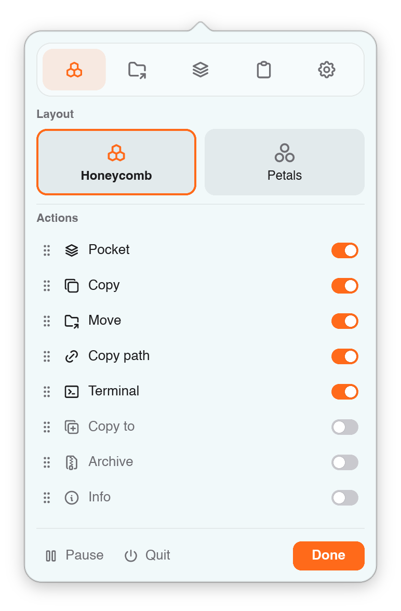
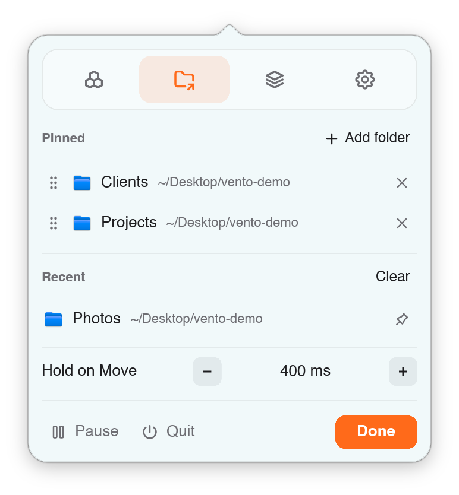
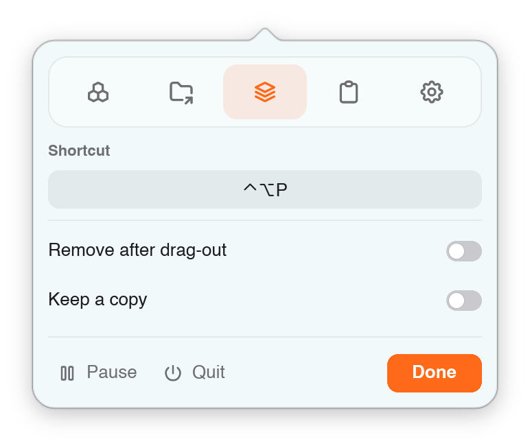
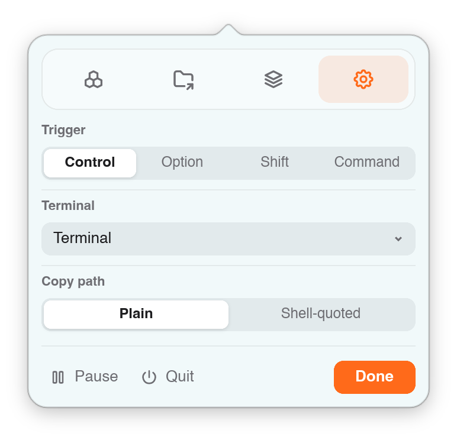

<p align="center">
  <picture>
    <source media="(prefers-color-scheme: dark)" srcset=".github/assets/logo-dark.png">
    
  </picture>
</p>

<p align="center">A wheel of quick actions that opens right under the file you are dragging.</p>


Start dragging a file, press **Ctrl**, and a small wheel opens under the pointer.
Let go over an action: copy the file, move it to a folder you use often, zip it,
park it in the Pocket for later, and more. Let go anywhere else and the drop
works as it always did.

## Download

**[Download the latest Vento](https://github.com/fathialamre/vento/releases/latest)**
(`vento-…-macos-arm64.zip`)

Needs macOS 13 or later on an Apple Silicon Mac (M1 or newer). Vento asks for no
special permissions: no Accessibility, no Input Monitoring.

On an Intel Mac, [build it yourself](BUILDING.md).

> **This is the macOS version.** Support for Linux and Windows is in progress:
> the core already builds and is tested on both, and the parts that talk to the
> system (drag detection, the wheel window, the Pocket) are being written for each.

## Install and first launch

1. Open the zip you downloaded. You get a `vento-…` folder with `Vento.app` in it.
2. Drag `Vento.app` into your **Applications** folder.
3. Open it.

Vento is not notarized by Apple yet, so the first time you open it macOS stops it
with a warning. You only need to get past this once.

**macOS 15 Sequoia and later**

1. Open Vento. macOS says it could not verify it. Click **Done**.

   

2. Open **System Settings → Privacy & Security** and scroll down to the message
   about Vento. Click **Open Anyway**, then confirm with your password or Touch ID.

   

**macOS 13 Ventura and 14 Sonoma**

1. In Applications, hold **Control** and click `Vento.app` (or right-click it).
2. Choose **Open**, then **Open** again in the dialog.

<details>
<summary>Still blocked?</summary>

If macOS says Vento "is damaged and can't be opened", it is reacting to the
download mark on the app, not to a real problem. Open the **Terminal** app,
paste this line and press Return, then open Vento again:

```sh
xattr -dr com.apple.quarantine /Applications/Vento.app
```

It removes the "downloaded from the internet" mark from Vento only.
</details>

Vento lives in the menu bar, not in the Dock. Look for this icon at the top of
your screen: 

## Your first drag

1. In Finder, **start dragging** a file or folder.
2. **While you are still dragging, press Ctrl.** The order matters: press Ctrl
   after the drag has started, not before.
   Or, without the keyboard, **shake the pointer** quickly back and forth, in
   any direction.
3. The wheel opens under the pointer. Move onto an action and let go.

Let go outside the wheel and the file drops wherever the pointer is, as usual.
Esc closes the wheel, where macOS lets Vento read the key without extra permission.

You can change the key from Ctrl to Option, Shift or Command in the settings.

A shake counts when the pointer comes back along the way it just moved four
times within about half a second, each swing at least 40 points. Small wiggles
and a drag that turns corners don't count. Shaking only works while dragging
files, like the wheel itself; turn it off with **Shake to open** in the
settings panel's General tab.

## The actions

The wheel shows **Pocket, Copy, Move, Copy path** and **Terminal** at first.
**Copy to, Archive** and **Info** are off until you switch them on in the
settings panel's **Wheel** tab, where you can also change the order.

### Pocket

A shelf for things you are carrying between places. Drop a file on **Pocket** and
it waits in a small island at the top of the screen, by the notch. Later, drag it
from the island into any folder or app.


Other ways to add to the Pocket: drop onto the island, or press **⌃⌥P**
(Control-Option-P). Click items to select several and
drag them together, or use **Drag all**. The x on an item removes it and
**Clear** empties the Pocket; both can be undone. Removing an item never deletes
your file.

### Copy

Puts the file on the clipboard, as if you had pressed ⌘C in Finder. Paste it
anywhere with ⌘V.

### Move

Let go on **Move** and a folder picker opens. Faster: **hold** on Move for a
moment and a ring of folders opens around it, with the places you moved things to
recently and the folders you pinned. Let go on a folder and the file goes there.


Changed your mind? Click **Undo** on the notice, or choose **Undo last move** from
the menu bar icon.

Pin up to seven folders in the settings panel's **Move** tab.

### Copy to *(off at first)*

Works like Move, with the same folder ring, but copies instead. Undo removes
the copies, as long as you have not changed them since.

### Archive *(off at first)*

Zips what you dragged, or unzips it if it is already an archive. Drop a folder
and you get a zip next to it; drop a zip, rar or 7z file and it is extracted next
to it.


Password-protected archives ask for the password. Vento never overwrites a file
(you get `Archive (2).zip` instead), and **Undo** moves what it made to the Trash.


### Copy path

Copies the full path of the file, ready to paste into a terminal, a chat or a
document.

### Terminal

Opens a Terminal window in the folder (or in the folder that holds the file).
You can pick iTerm or another terminal app in the settings.

### Info *(off at first)*

Shows how big a file or folder is. For a folder, the size counts up live, with
the three biggest things inside it.


## Clipboard

Vento remembers what you copy, so you can copy several things in one place and
paste them one by one somewhere else. Open the island and switch to the
**Clipboard** with the buttons at its bottom left, or press **⌃⌥V**
(Control-Option-V). Copying never opens the island by itself.

- **Click a copy** to put it back on the clipboard exactly as it was, formatting
  included (spreadsheet cells paste as cells), then press ⌘V anywhere.
- **Hover a copy** for three buttons: the **pin** keeps it until you remove it,
  the **Pocket** button adds it to the Pocket, and **x** removes it.
- **Filters** beside the list show everything, pinned copies only, or only
  text, links, pictures or files. Pictures copied in Finder show as pictures.
- **Clear** removes everything except pinned copies, and can be undone.
- Vento keeps the **50** newest copies plus every pinned one, and skips copies
  that password managers mark as concealed, and anything copied while Vento is
  paused.

The history stays after you quit or restart. It is stored **unencrypted** in
`~/Library/Application Support/vento`; see [SETTINGS.md](SETTINGS.md). Switch it
off, or change its shortcut, in the settings panel's **Clipboard** tab.

## Settings

**Click** the Vento icon in the menu bar to open the settings panel. Changes apply
right away.

| Wheel | Move |
|:---:|:---:|
|  |  |
| Honeycomb or petals layout; which actions show and in what order. | Pinned and recent folders for the Move ring, and how long to hold. |

| Pocket | General |
|:---:|:---:|
|  |  |
| The Pocket shortcut, and what happens after you drag items out. | The key that opens the wheel, shaking to open it, your terminal app, and how paths are copied. |

The **Clipboard** tab switches the clipboard history on or off, sets its
shortcut, and clears it.

**Right-click** the icon for the menu: undo the last move, copy or archive, pause
Vento, or quit.


Prefer a text file? Everything is also in `settings.toml`; see
[SETTINGS.md](SETTINGS.md).

## Uninstall

Right-click the menu bar icon, choose **Quit Vento**, and move `Vento.app` from
Applications to the Trash. To remove its settings, Pocket and clipboard history
too, delete the folder `~/Library/Application Support/vento`.

## For developers

Vento is written in Rust with a [Slint](https://slint.dev) interface. To run it
from source and start adding features:

```sh
git clone https://github.com/fathialamre/vento.git
cd vento
cargo run -p vento --release
```

[rustup](https://rustup.rs) installs the right Rust version on the first build.
[BUILDING.md](BUILDING.md) explains how the code is laid out, how to build the
app bundle and the release zip, and the checks to run before sending a change.
Help with Linux and Windows support is especially welcome.

## More

- [SETTINGS.md](SETTINGS.md): the settings file, and where Vento keeps its data
- [BUILDING.md](BUILDING.md): build Vento from source and work on the code

## License

GPL-3.0-only. See [LICENSE](LICENSE).

Wheel icons are from [Tabler Icons](https://tabler.io/icons) 3.49.0, MIT-licensed
(see [crates/vento/ui/icons/LICENSE-tabler](crates/vento/ui/icons/LICENSE-tabler)).
