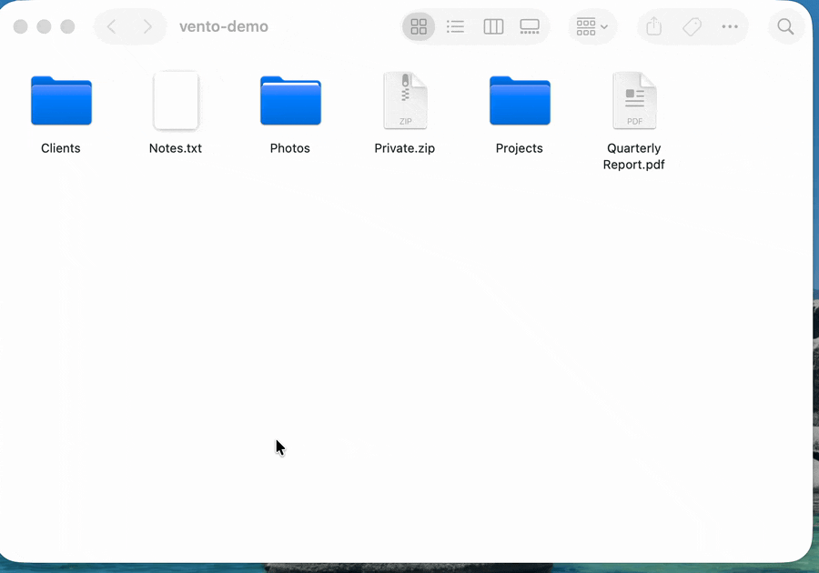
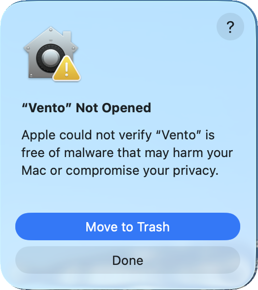
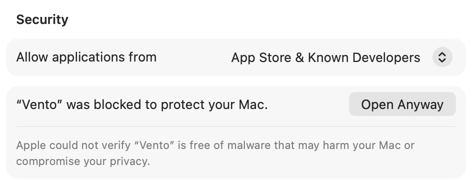
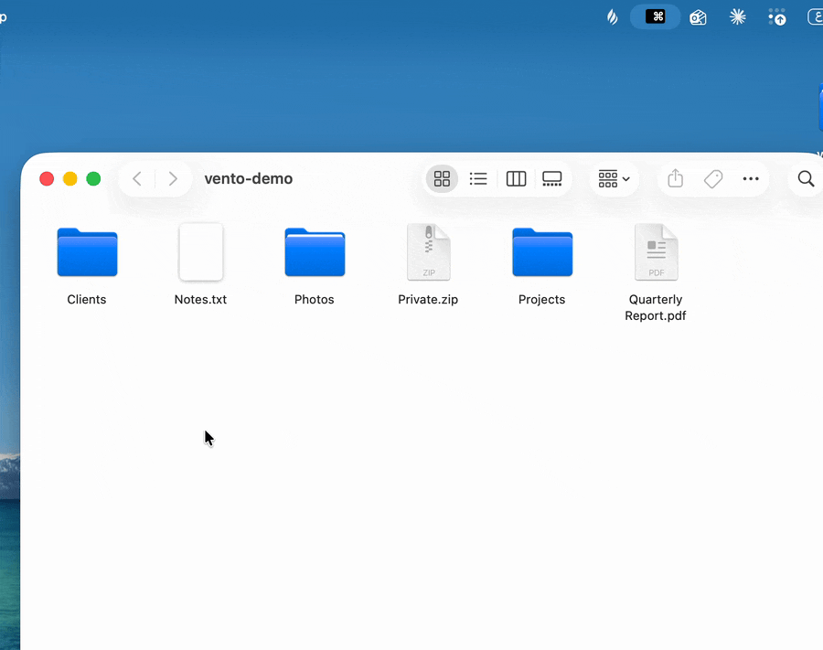
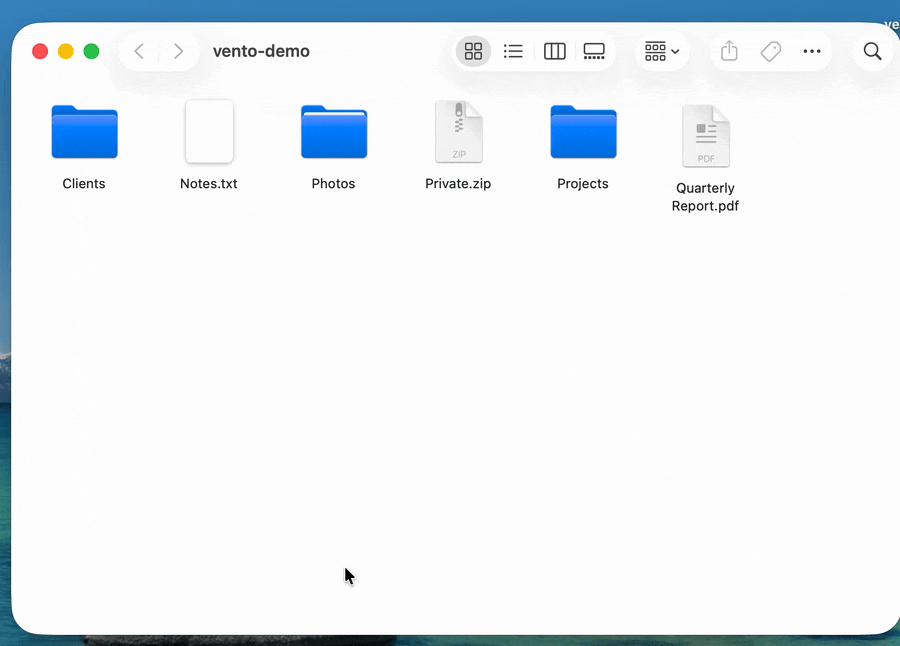
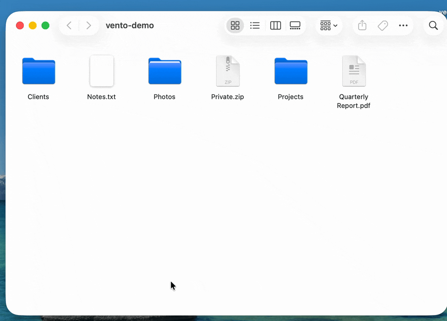
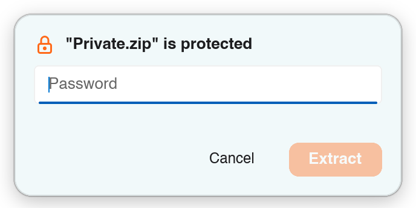
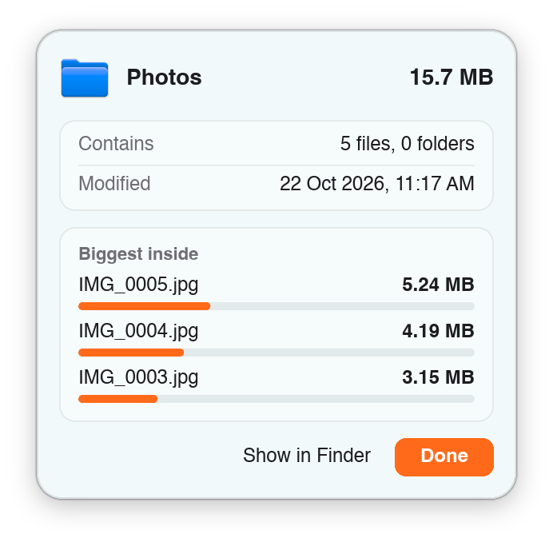
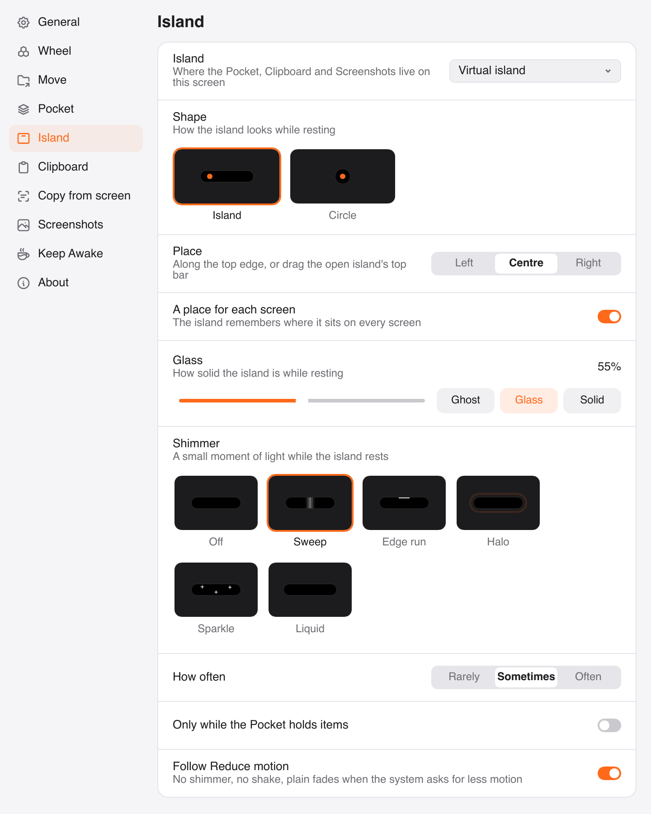
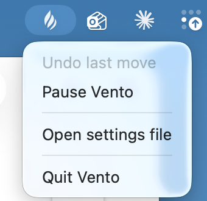

<p align="center">
  <picture>
    <source media="(prefers-color-scheme: dark)" srcset=".github/assets/logo-dark.png">
    
  </picture>
</p>

<p align="center">A wheel of quick actions that opens right under the file you are dragging.</p>

<p align="center">
  <a href="https://github.com/fathialamre/vento/releases/latest"></a>
  <a href="https://github.com/fathialamre/vento/releases"></a>
  <a href="https://github.com/fathialamre/vento/actions/workflows/ci.yml"></a>
  <a href="LICENSE"></a>
  <br>
  
  
  
  <a href="https://www.rust-lang.org"></a>
  <a href="https://github.com/fathialamre/vento/stargazers"></a>
</p>

<p align="center">
  <a href="https://fathialamre.github.io/vento/">Website</a> ·
  <a href="https://github.com/fathialamre/vento/releases/latest">Download</a> ·
  <a href="CHANGELOG.md">What's new</a> ·
  <a href="https://github.com/fathialamre/vento/issues">Report an issue</a>
</p>



Start dragging a file, press **Ctrl**, and a small wheel opens under the pointer.
Let go over an action: copy the file, move it to a folder you use often, zip it,
turn an image into JPEG, PNG, HEIC, WebP and other formats, park it in the
Pocket for later, and more. Let go anywhere else and the drop works as it
always did.

Vento runs on macOS, Windows and Linux (GNOME). It is free and open source.

**Contents:** [Download](#download) · [Install](#install-and-first-launch) ·
[First drag](#your-first-drag) · [Actions](#the-actions) · [The island](#the-island) ·
[Clipboard](#clipboard) · [Screenshots](#screenshots) · [Copy from screen](#copy-from-screen) ·
[Quick panel and Settings](#the-quick-panel-and-settings) · [Languages](#languages) ·
[Privacy](#privacy-and-network) · [Uninstall](#uninstall) · [For developers](#for-developers)

## Download

Vento is in **early beta**. If something breaks or feels off, please
[open an issue](https://github.com/fathialamre/vento/issues).

| System | Get it | Needs |
|---|---|---|
| **macOS** | **[Download the latest Vento](https://github.com/fathialamre/vento/releases/latest)** (`vento-…-macos-arm64.dmg`, or the `.zip` with the same files) | macOS 13 or later on Apple Silicon (M1 or newer). On an Intel Mac, [build it yourself](BUILDING.md). |
| **Windows** | The setup comes with the next release. Until then, [build it yourself](BUILDING.md#windows). | Windows 10 or 11, on an x64 or ARM64 PC. |
| **Linux** | **[Download the latest Vento](https://github.com/fathialamre/vento/releases/latest)** (`vento_…_amd64.deb`, or `_arm64.deb` on an ARM64 PC), or install from source, see [Linux](#linux). | Ubuntu 24.04 or later, with GNOME 46 to 50 on Wayland. |

Not there yet:

- **Windows:** Copy from screen, Share, and HEIC in Convert.
- **Linux:** Copy from screen, Share, the virtual island, and updating itself.

On macOS, Vento asks for no special permissions: no Accessibility, no Input
Monitoring. Only [Copy from screen](#copy-from-screen) asks for Screen
Recording, the first time you use it, and [Screenshots](#screenshots), if you
turn it on, may ask to see the folder your screenshots are saved in.

On macOS and Windows, Vento checks for new versions and updates itself (see
[Privacy and network](#privacy-and-network)). Mac versions before 0.3.0 cannot do
this yet, so if you have one, update it by hand once: download the latest disk image
and replace `Vento.app` as in [Install](#install-and-first-launch) below.

## Install and first launch

### macOS

1. Open the `.dmg` you downloaded. A window opens with `Vento.app` and a link to
   **Applications** (from the zip you get a `vento-…` folder with `Vento.app` in it).
2. Drag `Vento.app` onto **Applications**.
3. Open it.

Vento is not notarized by Apple yet, so the first time you open it macOS stops it
with a warning. You only need to get past this once.

**macOS 15 Sequoia and later**

1. Open Vento. macOS says it could not verify it. Click **Done**.

   

2. Open **System Settings → Privacy & Security** and scroll down to the message
   about Vento. Click **Open Anyway**, confirm with your password or Touch ID,
   then click **Open** in the last dialog.

   

**macOS 13 Ventura and 14 Sonoma**

1. In Applications, hold **Control** and click `Vento.app` (or right-click it).
2. Choose **Open**, then **Open** again in the dialog.

<details>
<summary>Still blocked?</summary>

If macOS says Vento "is damaged and can't be opened", it is reacting to the
download mark on the app, not to a real problem. Open the **Terminal** app,
paste this line and press Return, then open Vento again:

```sh
xattr -dr com.apple.quarantine /Applications/Vento.app
```

It removes the "downloaded from the internet" mark from Vento only.
</details>

Vento lives in the menu bar, not in the Dock. Look for this icon at the top of
your screen: 

The first time you use [Copy from screen](#copy-from-screen), a Vento window
explains why it needs Screen Recording and opens System Settings, where you switch
it on for Vento (macOS may also show its own prompt). After you switch it on,
macOS may ask you to reopen Vento. After each Vento update, switch it on again; if the switch does nothing,
remove Vento with the minus button and add it again.

### Windows

Run `vento-…-windows-setup.exe`. It installs Vento for you alone, with no
administrator rights, in `%LOCALAPPDATA%\Programs\Vento`, and starts it when you
sign in unless you untick that. One setup works on x64 and ARM64 PCs. Vento sits
in the notification area by the clock. If Windows says it protected your PC,
click **More info**, then **Run anyway**.

Until the first setup is published, [build it yourself](BUILDING.md#windows).

### Linux

Vento runs on GNOME on Wayland. A small GNOME Shell extension, installed with
it, tells Vento about the pointer, your drags and the clipboard, which Wayland
hides from apps. On Ubuntu 24.04 or later, install the package from the
[latest release](https://github.com/fathialamre/vento/releases/latest), in the
folder you downloaded it to:

```sh
sudo apt install ./vento_*_amd64.deb   # ./vento_*_arm64.deb on an ARM64 PC
```

It puts the app and the extension in place, turns the extension on and starts
Vento at every login. Log out and back in once so GNOME loads the extension.
The first launch asks you to allow Vento's global shortcuts.

On another system with GNOME, build it from source. The install script puts the
app, its launcher, the extension and a start at login in place for your user:

```sh
sudo apt install build-essential libfontconfig1-dev libxkbcommon-dev libglib2.0-dev libheif-dev libpoppler-glib-dev libxkbcommon-x11-0
git clone https://github.com/fathialamre/vento.git
cd vento
scripts/install-linux.sh
```

It needs [Rust](https://rustup.rs) and about 7 GB of memory for the release
build. Log out and back in once so GNOME loads the extension. To update, pull
the code and run the script again. More in [BUILDING.md](BUILDING.md#linux).

### The first launch

Vento opens a short setup the first time: pick a language and a look, try the wheel on a sample file, and choose what it shows.

## Your first drag

1. In Finder, Explorer or Files, **start dragging** a file or folder.
2. **While you are still dragging, press Ctrl.** The order matters: press Ctrl
   after the drag has started, not before.
   Or, without the keyboard, **shake the pointer** quickly back and forth, in
   any direction.
3. The wheel opens under the pointer. Move onto an action and let go.

Let go outside the wheel and the file drops wherever the pointer is, as usual.
Esc closes the wheel, where the system lets Vento read the key without extra permission.

You can change the key from Ctrl in the settings: to Option, Shift or Command on
a Mac, Alt, Shift or Win on Windows, and Alt, Shift or Super on Linux.

A shake counts when the pointer comes back along the way it just moved four
times within about half a second, each swing at least 40 points. Small wiggles
and a drag that turns corners don't count. Shaking only works while dragging
files, like the wheel itself; turn it off with **Shake to open** in the
**General** page of the Settings window.

## The actions

The wheel shows **Pocket, Copy, Move, Copy path** and **Terminal** at first.
**Copy to, Archive, Convert, Info, PDF, Rename** and **Share** are off until you switch them
on in the **Wheel** page of the Settings window, where you can also change the
order.

### Pocket

A shelf for things you are carrying between places. Drop a file on **Pocket** and
it waits in the [island](#the-island) at the top of the screen. Later, drag it
from the island into any folder or app.



Other ways to add to the Pocket: drop onto the island, or press **⌃⌥P**
(Control-Option-P; Ctrl+Alt+P on Windows and Linux). Click items to select several and
drag them together, or use **Drag all** at the bottom right. The x on an item
removes it and **Clear** empties the Pocket; both can be undone. Removing an item
never deletes your file.

The Pocket has two looks, switched with the two buttons beside **Drag all**:

- **By kind** (the default) groups the items: **Images, Video, Audio,
  Documents, Archives, Folders** and **Other**, each a row of tiles. Pictures
  show as pictures. **Drag N** beside a group takes all its files along; its
  name, or the **+N** tile at the end of a full row, opens the list on just that
  kind.
- **List** shows every item as a row with what it is, its size and its folder,
  and chips along the top to show only one kind. Hover a row for **Show in
  Finder**, **Copy path** and **x**; the arrow at its end opens a preview under
  it: the picture, what a folder holds, or the item's kind, size, place and when
  it came in. **Kinds** at the top left goes back.

Drag a tile or a row out like any item. Which look the island opens on is set
in **Settings → Pocket**.

### Copy

Puts the file on the clipboard, as if you had pressed ⌘C in Finder (Ctrl+C in
Explorer or Files). Paste it anywhere with ⌘V (Ctrl+V).

### Move

Let go on **Move** and a folder picker opens. Faster: **hold** on Move for a
moment and a ring of folders opens around it, with the places you moved things to
recently and the folders you pinned. Let go on a folder and the file goes there.



Changed your mind? Click **Undo** on the notice, or choose **Undo last move** from
the menu bar icon.

Pin up to seven folders on the **Move** page of the Settings window.

### Copy to *(off at first)*

Works like Move, with the same folder ring, but copies instead. Undo removes
the copies, as long as you have not changed them since.

### Archive *(off at first)*

Zips what you dragged, or unzips it if it is already an archive. Drop a folder
and you get a zip next to it; drop a zip, rar or 7z file and it is extracted next
to it.



Password-protected archives ask for the password. Vento never overwrites a file
(you get `Archive (2).zip` instead), and **Undo** moves what it made to the Trash.



### Convert *(off at first)*

Changes an image to another format. **Hold** on Convert for a moment and a ring
of formats opens: JPEG, PNG, HEIC, WebP, TIFF, GIF and BMP. Let go on one and
the new image appears next to the original, which is never touched. Drop several
images and they are all converted.

Vento reads the picture itself, not the file name, so a `.png` that is really a
JPEG still works. Photos stay upright, colours are kept, and transparent areas
become white when you pick JPEG or BMP. Vento never overwrites a file (you get
`photo (2).jpg` instead), and **Undo** moves what it made to the Trash.

### PDF *(off at first)*

Works on PDF files, on macOS, Windows and Linux. Drag one or more PDFs and let go
on **PDF**: a window opens that shows every page. The cell is dimmed when
nothing you are dragging is a PDF.

In the window you can put several files together in one (drop more PDFs on it
or use **Add**), delete pages, drag pages into a new order and rotate them. The
files are listed in a sidebar (**Files** hides or shows it); click one to select
its pages. Nothing is written until you ask:

- **Save as new PDF** (⌘S, or Ctrl+S on Windows and Linux) writes the pages as they now stand.
- **Extract** writes only the pages you selected.
- **Split** cuts the file into several: every page, every N pages, or at the
  places you click between pages.
- **Images** turns pages into PNG or JPEG pictures, at **Print** (300 DPI) or
  **Screen** (150 DPI) quality.

Every result is new and sits next to the original, which is never changed: a
new file, or, for **Split** and for **Images** with several pages, a new
folder of files (`report split`, `report images`). Vento never overwrites a file
(you get `report (edited).pdf`, then `report (edited) (2).pdf`). Closing a
window with changes, or quitting Vento, asks whether to save them. The window's
footer says what was written, with **Show in Finder** (**Show in Explorer** on
Windows, **Show in Files** on Linux) and **Undo**; **Undo**
there, on the notice once the window has closed, or from the menu bar icon,
moves what was written to the Trash. A PDF that is locked with a password is
skipped.

### Rename *(off at first)*

Renames many files and folders at once, on macOS, Windows and Linux. Drag them
and let go on **Rename**: a window lists every item with its new name beside
it, and the new names change as you type. Nothing is renamed until you press
**Rename** (⌘↩, or Ctrl+Enter on Windows and Linux).

Pick a tool along the top to add a rule. Rules run in the order you added them,
each shown as a chip you can click to change or ✕ to remove:

- **Replace** finds text in every name and replaces it (leave **Replace with**
  empty to remove it), with **Match case** if you need it.
- **Add** puts text before or after the name.
- **Number** adds 001, 002… before or after the name, with the start, the
  number of digits and a separator you choose.
- **Case** makes names lowercase, UPPERCASE, Title Case, kebab-case or
  snake_case.
- **Extension** changes the part after the last dot: lowercase, UPPERCASE,
  replaced with another, or removed. Only the name changes: the file is not
  converted (that is what **Convert** is for).
- **Template** builds the whole name from parts: `{name}`, a counter `{n}`
  (`{n:3}` for 001), the folder's name `{folder}` and the date it was last
  changed `{modified}`.

Every rule but Extension leaves the extension alone, so `IMG_4821.HEIC` stays a
`.HEIC`. **⌘Z** (Ctrl+Z) in the window takes back the last change to the rules.
**Order** sorts the list, and with it the numbers, by **Name** (`2` before `10`),
**Date** modified (oldest first) or **Size** (smallest first), with **Reverse**;
folders always come first. **Folders** shows when you dragged a folder and is on
at first: switch it off to leave the folders' names alone. A folder is renamed
as one item; what is inside it is never touched. The window remembers your last
rules and order for next time.

A row that cannot be renamed turns red and says why: two items would get the
same name, the name is already taken in that folder, it is empty or too long, or
it has a character the system does not allow (`:` on macOS; `\ / : * ? " < > |`,
names such as `CON` and a dot or space at the end on Windows). **Rename** stays
off until every row is fine. Swapping two names, or changing only the case
(`.JPG` to `.jpg`), works.

Vento never overwrites a file. If anything goes wrong half-way, every name goes
back as it was and the notice says which item failed. **Undo** on the notice, or
**Undo last rename** from the menu bar icon, puts every old name back; an item
you have renamed, moved or deleted since is left as it is. Up to 5,000 items
can be renamed at once.

### Share *(off at first)*

Sends what you dragged with the Mac's own sharing (macOS only for now). Let go
on **Share** and AirDrop opens with your files in it, ready for you to pick a
device. On a Mac without AirDrop, the system's share menu opens instead.

**Hold** on Share for a moment and a ring opens: **Messages, Mail, Notes** and
**More…**. Let go on one and its window opens with your files in it. **More…**
opens the system's share menu, which lists every app that can share, such as
WhatsApp or Telegram when their share extensions are on. A Mac without
Messages, Mail or Notes simply has fewer cells on the ring.

Everything goes as it is, folders too. AirDrop sends a folder, and Mail zips it
itself. When a service cannot take what you dropped, a notice says so. Notes
cannot take a folder together with files: drop the folder on its own, or zip it
with **Archive** first (switch Archive on in **Settings → Wheel** if it is not
on the wheel).

Share writes nothing, so there is nothing to **Undo**, and it asks for no
permission. A notice appears only when something goes wrong; otherwise the
service's own window is all you see.

### Copy path

Copies the full path of the file, ready to paste into a terminal, a chat or a
document.

### Terminal

Opens a Terminal window in the folder (or in the folder that holds the file).
You can pick iTerm or another terminal app in the settings.

### Info *(off at first)*

Shows how big a file or folder is. For a folder, the size counts up live, with
the three biggest things inside it.



## The island

The island at the top of the screen holds the Pocket, your clipboard history and
your screenshots, a tab each. Where it sits depends on the screen:

- **A Mac with a notch:** it grows wings beside the notch.
- **Other Mac screens and Windows:** the [virtual island](#the-virtual-island)
  on the top edge, or, chosen in **Settings → Island**, the plain pill under the
  menu bar on a Mac or the island by the taskbar's clock on Windows.
- **Linux:** in GNOME's top bar, beside the clock, in a room the extension keeps for it.

<p>
  
  
  
</p>

### The island shows your jobs

Copy, move, zip, convert or rename, and the island wakes up: it says what is
running and how far along it is, with **Cancel**. Then it shows the result with
one button, such as **Show** or **Undo**, and goes back to rest. On a Mac with a
notch the notch island does the same on its wings; switch this off in
**Settings → Island**.

### The virtual island

On a screen without a notch, the virtual island rests as a small glass pill on
the top edge (under the menu bar on a Mac). It never takes a click, so it can
sit over a window's tab bar. **Push the pointer against the top edge** under it
and it opens. Resting, it shows how many items the Pocket holds and how long
Keep Awake has left; while Vento is paused it turns grey, with **Resume**.

New installs start with the virtual island where it is offered; switch between
it and the other island in **Settings → Island**, which also holds:

- **Shape:** the **Island**, a short pill, or the **Circle**, a small disc that
  stretches into a pill only to say something.
- **Place:** **Left**, **Centre** or **Right**, or drag the open island's top
  bar anywhere along the edge (double-click it to put the island back in the
  middle). **A place for each screen** lets every screen keep its own.
- **Glass:** how solid it is while resting, from 10% to 100%, with **Ghost**,
  **Glass** and **Solid** presets.
- **Shimmer:** a small moment of light now and then: **Sweep**, **Edge run**,
  **Halo**, **Sparkle**, **Liquid**, or **Off**; how often (**Rarely**,
  **Sometimes** or **Often**), and whether only while the Pocket holds items.
- **Follow Reduce motion:** when the system asks for less motion, no shimmer, no
  shake and plain fades.



On Linux the virtual island is not offered yet: the island stays in the top bar.

## Clipboard

Vento remembers what you copy, so you can copy several things in one place and
paste them one by one somewhere else. Open the island and switch to the
**Clipboard** with the tabs at its bottom left, or press **⌃⌥V**
(Control-Option-V; Ctrl+Alt+V on Windows and Linux). Copying never opens the island by itself.

- **Click a copy** to put it back on the clipboard exactly as it was, formatting
  included (spreadsheet cells paste as cells), then press ⌘V anywhere.
- **Hover a copy** for three buttons: the **pin** keeps it until you remove it,
  the **Pocket** button adds it to the Pocket, and **x** removes it.
- **The arrow** at the end of a copy opens a preview under it: the whole text,
  the picture, a link's site and address, or the files' names, with **Copy**,
  **Open in browser** or **Show in Finder**, and **Remove**.
- **Filters** along the top show everything, pinned copies only, or only
  text, links, pictures or files. Pictures copied in Finder show as pictures.
- **Clear**, at the bottom right, removes everything except pinned copies, and
  can be undone.
- Vento keeps the **50** newest copies plus every pinned one, and skips copies
  that password managers mark as concealed, and anything copied while Vento is
  paused.

The history stays after you quit or restart. It is stored **unencrypted** in
Vento's data folder (`~/Library/Application Support/vento` on a Mac); see
[SETTINGS.md](SETTINGS.md). Switch it
off, or change its shortcut, on the **Clipboard** page of the Settings window.

## Screenshots

Off by default; turn it on in **Settings → Screenshots**. Vento reads the folder
the Screenshot app saves to (**⇧⌘5 → Options**), or on Windows and Linux the
Screenshots folder in your Pictures folder (created if missing). A **card** then drops down from the
island for each new screenshot: drag the picture anywhere, or **Copy**, **Copy text** (the text found in it; macOS 14+, or
Tesseract on Linux), **Pocket**, **Move to Trash** (**Undo** for about 5 seconds).
It closes after 2 to 8 seconds, not while the pointer is on it. <!-- screenshot: card -->

The **Screenshots** tab, beside Clipboard and Pocket, lists the last 7 days (up
to 60) by day, with a closer look and **Show in Finder**. <!-- screenshot: tab -->

When you turn it on, macOS may ask once to let Vento see the folder your
screenshots are saved in (the Desktop, Documents or Downloads). It ties that
permission to the exact build, and Vento is not signed by Apple yet, so after an
update it may ask again, only when you open the tab or its Settings page, never
at launch. **Tip:** the Screenshot app's floating thumbnail makes macOS save the
file about 5 seconds late; turn off **Show Floating Thumbnail** for an instant card.

## Copy from screen

Copy the text from anything on your screen, even a picture, a video or an app
that won't let you select it. macOS only for now. Press **⌃⌥T** (Control-Option-T), or choose
**Copy from screen** in the menu bar menu. The screen dims. Drag a rectangle over
the text and let go: the text inside it is on your clipboard, ready to paste with
⌘V. Esc, a right click, or a click without dragging cancels.

It reads English and Arabic on your Mac, with nothing sent anywhere. Arabic needs
a recent macOS; older versions may read only some languages. It needs macOS 14 or
later, and asks for **Screen Recording** the first time you use it (see
[install](#install-and-first-launch) for what to do after an update). macOS 15
and later may ask you from time to time to confirm that Vento can keep recording
the screen; that is normal. Change the shortcut on the **Copy from
screen** page of the Settings window.

## The Quick panel and Settings

**Click** the Vento icon in the menu bar (on Windows, in the notification area;
on Linux, in the top bar) to open the Quick panel. It tells you
whether Vento is on or paused, with a button to pause or resume it, and puts the
things you reach for most one click away:

- **Copy text** starts [Copy from screen](#copy-from-screen). It is left out on
  a Mac that cannot do that.
- **Clipboard** opens the island on your clipboard history.
- **Pocket** opens the island on the Pocket and says how many items it holds.
- **Keep Awake** keeps your computer awake, and its screen on unless you choose
  otherwise on the Keep Awake page of Settings. Click the tile to start or
  stop it, or pick how long below it: from 15 minutes up to 8 hours, until a time you
  choose, or until you stop it. The Keep Awake page of Settings picks those
  times (up to six, from 5 minutes to 24 hours) and what a click on the tile
  starts. While it runs a small cup shows beside the Vento icon; click the cup
  to open the panel.

After a move, copy or archive, an **Undo** row appears at the bottom. While Vento
is paused, Copy text, Clipboard and Pocket are greyed out; **Resume** brings them
back.

Choose **Settings…** to open the **Vento Settings** window. It stays open while
you work, and choosing Settings… again brings it forward. Pick a page on the left;
changes apply right away. Each page shows its settings on one panel, most with
a short line on what they do; General shows the looks and the themes as small
pictures to click. Every page but About ends with a **How to use** section that
shows how to use its feature in a few steps. Click its header to close it;
it stays closed until you open it again.

| Page | What it holds |
|---|---|
| General | The **Language** (one of the [eight](#languages), or follow the system), the key that opens the wheel, shaking to open it, your terminal app, how paths are copied, **Appearance** (follow the system, or always light or dark), and the **Theme** of the Quick panel and this window: Vento, GitHub, Catppuccin, Rosé Pine, Tokyo Night, Gruvbox or Nord. |
| Wheel | Honeycomb or petals layout; which actions show and in what order. |
| Move | Pinned and recent folders for the Move ring, and how long to hold. |
| Pocket | The Pocket shortcut, what happens after you drag items out, and which look it opens on: By kind or List. |
| Island | The [virtual island](#the-virtual-island) or the other island, and the virtual island's shape, place, glass and shimmer; on a notch, whether it shows jobs. |
| Clipboard | Clipboard history on or off, its shortcut, and clearing it. |
| Copy from screen | Its shortcut. |
| Screenshots | Screenshots in the island on or off, the card on or off, and how long the card stays. |
| Keep Awake | The times the Quick panel offers, what a click on the tile starts, and whether the screen may turn off while Keep Awake runs. |
| About | The version, and on macOS and Windows the update status with **Check now** and a switch for the daily check; what's new in this version; a button that opens the settings file, and one that shows the licenses. |

The wheel, the Pocket and the notices that offer Undo keep their dark look
whichever Appearance or Theme you choose.

**Right-click** the icon for the same things as a menu: Copy from screen, the
clipboard history, the Pocket, the screenshots (when they are on), Keep Awake, undo the last move, copy or archive,
pause Vento, Settings…, open the settings file, or quit.



Prefer a text file? Everything is also in `settings.toml`; see
[SETTINGS.md](SETTINGS.md).

## Languages

Vento speaks **English**, **العربية** (Arabic), **Español**, **Français**,
**Italiano**, **Português (Portugal)**, **Português (Brasil)** and **Türkçe**.
In Arabic the whole interface is mirrored to read right to left. The windows, the
menu and the next notice change as soon as you pick a language, with no restart.

The language is English until you pick another in **Settings → General →
Language**. The first choice there, **Automatic (system language)**, follows your system's preferred languages (on Linux,
the `LANGUAGE`, `LC_ALL`, `LC_MESSAGES` and `LANG` variables) and falls back to
English; each language is listed under its own name. Or set
`language` in `settings.toml` (see [SETTINGS.md](SETTINGS.md)). To add another
language, see [lang/README.md](lang/README.md).

## Privacy and network

On macOS and Windows, Vento makes one request a day to GitHub to look for a new version,
and nothing else: it sends no data about you or your files, and has no
analytics. When a newer version exists, Vento downloads it only after you click
**Update** in the Quick panel or in **Settings → About**, and checks the
download against the checksums published with the release before it replaces
itself. Everything else, including Copy from screen, runs on your computer.

Turn the daily check off with **Settings → About → Check for updates
automatically**. **Check now** still works when you ask for it. There is no
update check on Linux, where you update by installing the newer package, or by
running the install script again.

## Uninstall

- **macOS:** right-click the menu bar icon, choose **Quit Vento**, and move
  `Vento.app` from Applications to the Trash. To remove its settings, Pocket and
  clipboard history too, delete the folder `~/Library/Application Support/vento`.
- **Windows:** uninstall Vento from **Settings → Apps → Installed apps**. Your
  settings and Pocket stay in `%APPDATA%\vento`; delete that folder to remove them.
- **Linux:** run `sudo apt remove vento` if you installed the package, or
  `scripts/install-linux.sh --uninstall` if you built it. Both keep your
  settings and data in `~/.config/vento` and `~/.local/share/vento`.

## For developers

Vento is written in Rust with a [Slint](https://slint.dev) interface. To run it
from source and start adding features:

```sh
git clone https://github.com/fathialamre/vento.git
cd vento
cargo run -p vento --release
```

[rustup](https://rustup.rs) installs the right Rust version on the first build.
[BUILDING.md](BUILDING.md) explains how the code is laid out, how to build the
app and the release files for each system, and the checks to run before sending a change.
Help with Linux and Windows support is especially welcome.

## More

- [SETTINGS.md](SETTINGS.md): the settings file, and where Vento keeps its data
- [BUILDING.md](BUILDING.md): build Vento from source and work on the code
- [lang/README.md](lang/README.md): the translations, and how to add a language

## License

GPL-3.0-only. See [LICENSE](LICENSE).

Wheel icons are from [Tabler Icons](https://tabler.io/icons) 3.49.0, MIT-licensed
(see [crates/vento/ui/icons/LICENSE-tabler](crates/vento/ui/icons/LICENSE-tabler)).

Arabic is shown in [IBM Plex Sans Arabic](https://github.com/IBM/plex), under the
SIL Open Font License 1.1
(see [crates/vento/ui/fonts/LICENSE-ibm-plex](crates/vento/ui/fonts/LICENSE-ibm-plex)).
